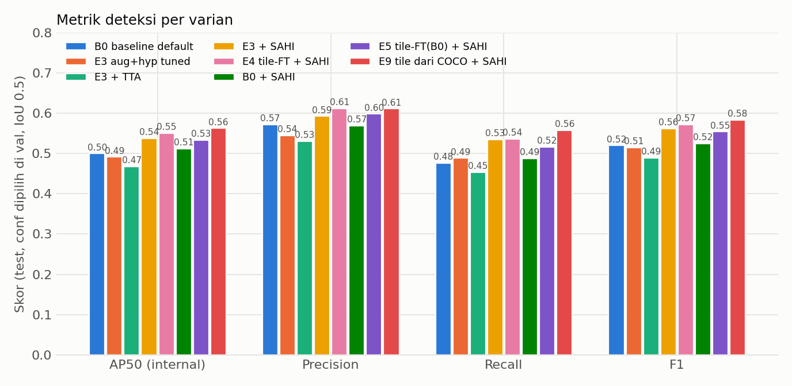
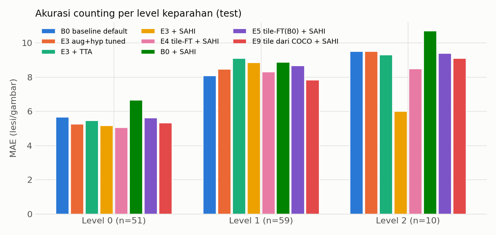
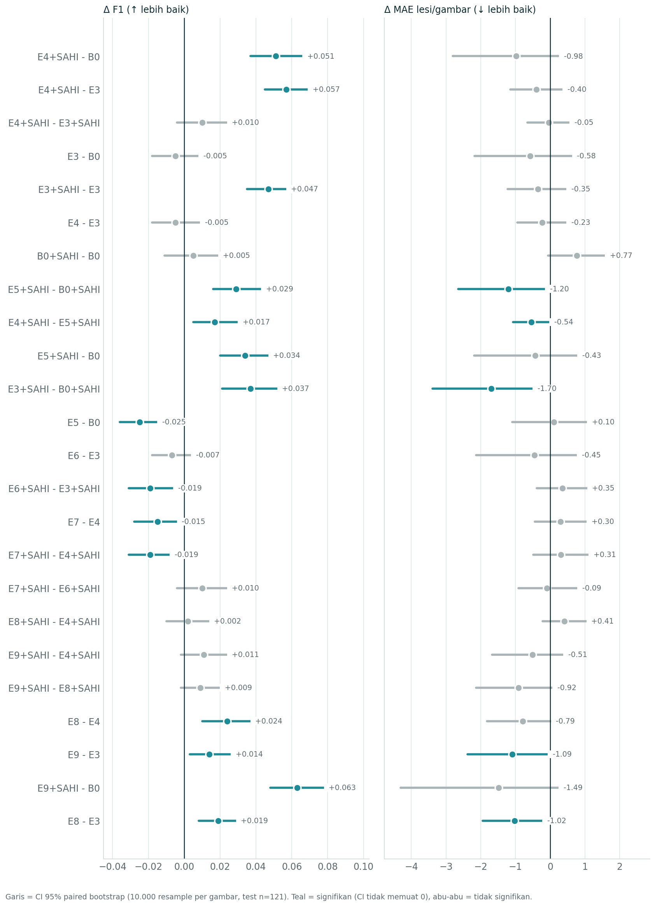
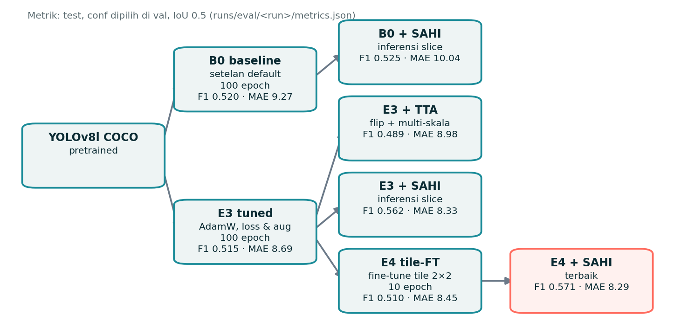
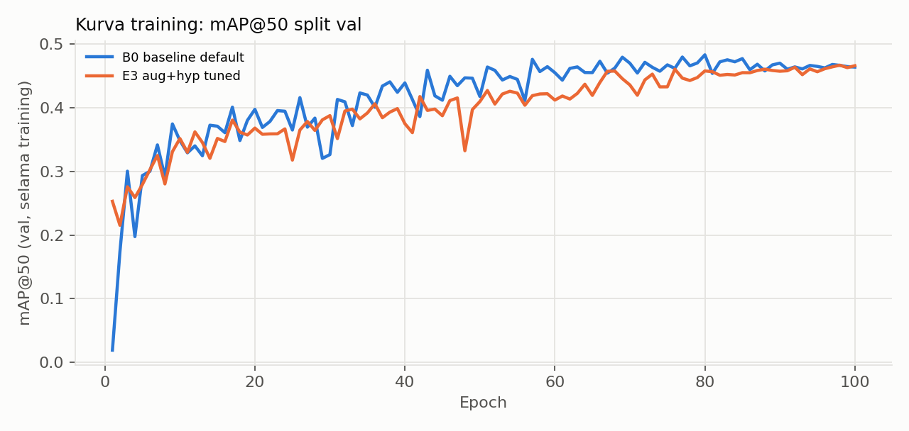
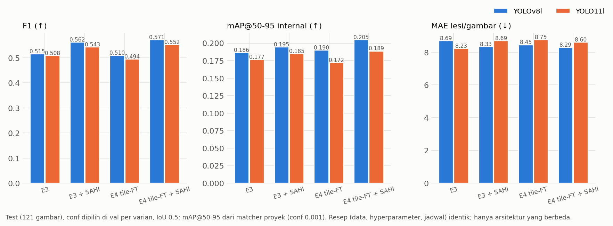
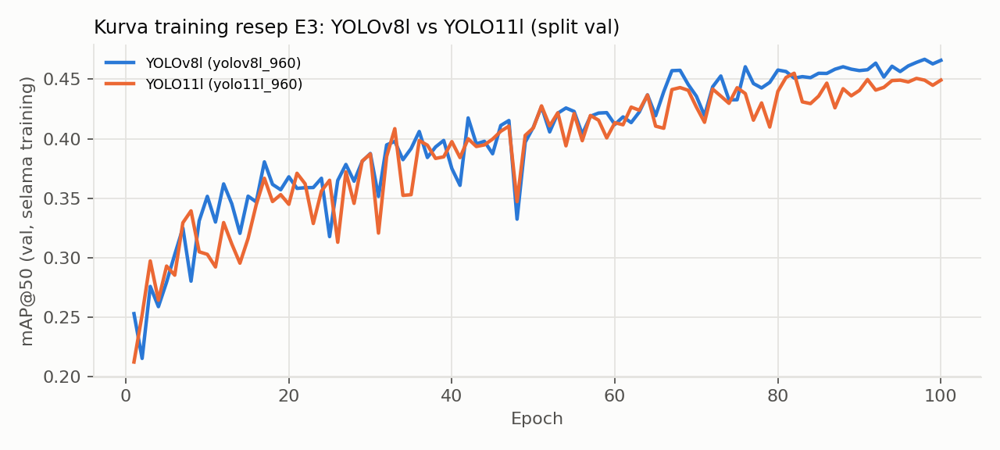
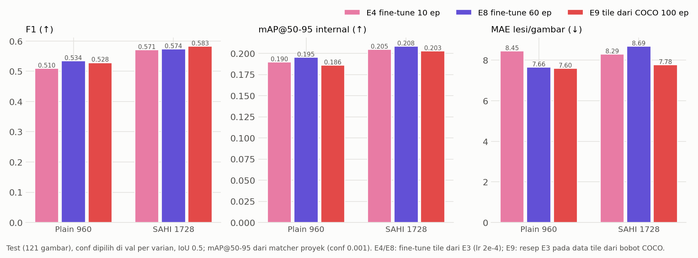
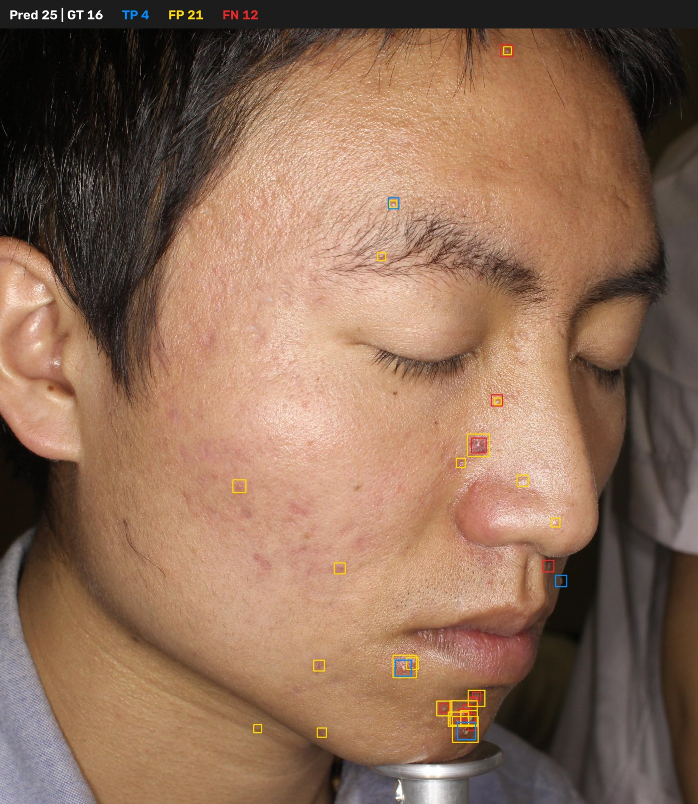

# Laporan Hasil Model AcneVision

> Tanggal: 2026-10-25 (E5 ditambahkan) · `ultralytics 8.4.170`, `torch 2.6.0+cu124`, RTX 4060 8 GB
> Semua angka berasal dari artefak `runs/eval/<run>/metrics.json`, `counts_test.csv`,
> `runs/predict/<run>/test/predictions.csv`, dan `docs/report/{summary,bootstrap}.json`.
> Grafik dibuat oleh `scripts/report.py`. Bagian bertanda *opini* adalah interpretasi penulis.

---

## 0. Ringkasan Eksekutif

| | Baseline **B0** | Terbaik **E4 + SAHI** | Δ (bootstrap 95% CI) |
|---|---|---|---|
| Model | YOLOv8l default @960 | YOLOv8l tuned (E3) → fine-tune tile 2×2, inferensi SAHI 1728 px | |
| AP@50 (test, IoU 0.5) | 0.499 | **0.550** | +5.1 poin |
| Precision / Recall | 0.572 / 0.476 | **0.611 / 0.536** | Recall +0.059 [+0.040, +0.077] |
| F1 | 0.520 | **0.571** | +0.051 [+0.037, +0.066] |
| MAE counting (lesi/gambar) | 9.27 | **8.29** | −0.98 [−2.80, +0.26] (tidak signifikan) |
| Pearson r (jumlah) | 0.860 | **0.943** | |
| Latency end-to-end | **69 ms** | 628 ms | ±9× lebih lambat |

Test = 121 gambar, 3.507 lesi. Conf operasional dipilih di **val** (B0: 0.26, E4+SAHI: 0.22).

**Temuan utama:**
1. **Resolusi efektif adalah tuas terbesar.** SAHI (slice 1728 px → 960) menaikkan F1 dan recall secara
   signifikan pada E3. Fine-tune pada tile (E4) menambah sedikit (+1.0 poin F1, tidak signifikan vs E3+SAHI).
2. **Tuning augmentasi/hyperparameter (E3) tidak menaikkan deteksi plain** dibanding setelan default (B0):
   mAP@50 0.498 vs 0.4997. Perbaikan counting E3 (MAE 8.69 vs 9.27) juga tidak signifikan.
   Namun **bersama SAHI, tuning E3 berpengaruh**: E3+SAHI − B0+SAHI ΔF1 +0.037, ΔMAE −1.70 (signifikan).
3. **Desain 2×2 (E5, §5.6)**: fine-tune tile dari B0 menaikkan F1 B0+SAHI secara signifikan (+0.029),
   tetapi E4+SAHI tetap lebih baik dari E5+SAHI (+0.017, signifikan). Kedua faktor (bobot awal E3 dan
   fine-tune tile) sama-sama berkontribusi bila inferensi memakai SAHI.
4. **YOLO11l tidak mengungguli YOLOv8l** pada resep yang sama (E6/E7, §5.8): F1 turun 0.015–0.019
   (signifikan untuk SAHI dan tile-FT), MAE tidak berbeda nyata. Keunggulannya hanya efisiensi
   (25,3 jt vs 43,6 jt parameter; 61 vs 70 ms plain).
5. **TTA memperburuk** semua metrik deteksi (AP50 0.467 vs 0.491).
6. Model terbaik **memenuhi semua ambang "minimum layak"** di `SPEC.md`, dan ambang "baik" untuk
   Precision dan Pearson r. MAE (≤7) dan latency (<100 ms) belum mencapai "baik".
7. Kelemahan utama: **under-count pada wajah sangat padat** (1 gambar level 3: 264 dari 434 lesi) dan
   lesi < 16 px.

**Pembaruan (E8/E9, §5.9):** training tile dari bobot COCO (**E9**) kini terbaik: E9 + SAHI F1 0.583, recall
0.557, AP@50 0.562, MAE 7.78, r 0.961 (test, conf 0.21 dari val). Recall-nya signifikan di atas E4 + SAHI (+0.020),
F1 belum (+0.011 [−0.002, +0.024]). Bobot yang sama dalam mode plain (±70 ms) juga signifikan lebih baik dari E3
(ΔF1 +0.014, ΔMAE −1.09).

**Rekomendasi:** gunakan **E9** sebagai satu bobot untuk dua mode: **E9 + SAHI 1728** bila akurasi diutamakan,
**E9 plain** bila latency < 100 ms dibutuhkan. Penetapan model terpilih di `SPEC.md` menunggu keputusan pengguna.

---

## 1. Tujuan & Cakupan

Mendeteksi dan **menghitung** lesi jerawat pada foto wajah (1 kelas `acne`). Counting adalah metrik
utama secara klinis; deteksi (mAP/P/R) mengukur kualitas lokalisasi. Cakupan laporan: pengembangan
model saja (serving/ONNX di luar cakupan).

## 2. Dataset

| Item | Nilai |
|---|---|
| Sumber | Gambar ACNE04 (Wu et al., ICCV 2019) + anotasi **ACNE04-v2** (Gazeau et al., MICCAI 2024) |
| Anotasi | Lingkaran (cx, cy, r) → bbox persegi `[cx±r, cy±r]` |
| Split (acak, seed 42) | 963 / 120 / 121 gambar · 25.521 / 3.366 / 3.507 lesi |
| Level keparahan test | level 0: 51 · level 1: 59 · level 2: 10 · level 3: **1** |
| Resolusi | ±3456×3112 px |

**Ukuran lesi** (train, sisi terpanjang bbox; sumber `PIPELINE.md` §1, `scripts/diagrams.py`):
median 42 px di resolusi asli. Pada `imgsz=960` median menjadi **11.7 px** dan **73.5%** lesi < 16 px
(`report/figures/lesion_size_hist.png`). Inilah alasan teknik berbasis
resolusi (SAHI, tiling) diprioritaskan.

## 3. Metodologi

### 3.1 Pipeline
```
data/ (YOLO) ─► train.py + configs/*.yaml ─► best.pt (dipilih di val)
                                         └─► evaluate.py ─► metrics.json, confusion matrix, counts_test.csv
data_tiles2/ (preprocess.py, tile 2×2) ─► E4 fine-tune             └─► predict.py --compare (121 gambar test)
```

### 3.2 Protokol evaluasi (`scripts/evaluate.py`)
1. **mAP Ultralytics** pada test: `conf=0.001`, `iou=0.7`, `max_det=1000`, `imgsz` = training
   (tidak tersedia untuk SAHI).
2. **AP@50 internal**: prediksi dicocokkan ke GT secara greedy (skor menurun, IoU ≥ 0.5), interpolasi
   101 titik. Satu definisi untuk semua mode (plain/TTA/SAHI), sehingga sebanding. Nilainya
   konsisten dengan mAP Ultralytics (B0: 0.4994 vs 0.4997). **mAP@50-95 internal** (ditambahkan
   2026-10-24, `map50_95_test_internal`) = rata-rata AP yang sama pada IoU 0.50:0.05:0.95. Diverifikasi
   ulang pada `predictions.json` Ultralytics (4 run plain/TTA): selisih ≤ 0.0002 (mAP@50) dan ≤ 0.0024
   (mAP@50-95). Hasil (test, `rerun_evals.ps1`): B0 0.1923, E3 0.1863,
   E3 + TTA 0.1810, E3 + SAHI 0.1945, E4 + SAHI 0.2046, B0 + SAHI 0.1903.
3. **Threshold conf operasional dipilih di val** (grid 0.05–0.60, MAE counting minimum), lalu
   diterapkan sekali ke test: Precision, Recall, F1, MAE, RMSE, bias, Pearson r, per level.
   Ditambahkan 2026-11-13 (§5.11): MAE/RMSE relatif (÷ rata-rata GT per gambar) dan **grading Hayashi**
   dari jumlah lesi (accuracy, precision, sensitivity, specificity, Youden; protokol metrik Wu et al. 2019).
4. **Confusion matrix** pada conf operasional (§5.4).
5. **Signifikansi**: paired bootstrap per gambar (10.000 resample, seed 42) untuk selisih MAE, F1,
   dan recall (`docs/report/bootstrap.json`).
6. **Latency**: median waktu end-to-end per gambar test (baca gambar + inferensi + NMS), GPU idle.

### 3.3 Varian yang dibandingkan

| ID | Run (`runs/detect/`) | Perubahan | Training |
|---|---|---|---|
| **B0** | `yolov8l_960_default` | YOLOv8l COCO, **setelan default** Ultralytics (optimizer `auto`, augmentasi default), 100 epoch | 100 ep, best ep 80 |
| **E3** | `yolov8l_960` | AdamW lr0 1e-3 cosine, loss box 10 / cls 0.3 / dfl 2.0, flipud 0.5, degrees 10, mixup 0.1 | 100 ep, best ep 98 |
| E3 + TTA | (E3) | `augment=True` saat inferensi (flip + multi-skala) | – |
| E3 + SAHI | (E3) | Sliced inference: slice 1728 px, overlap 0.2, tiap slice di-resize ke 960, NMS IoU 0.5 | – |
| **E4** | `yolov8l_960_tiles2_ft` | **Preprocessing tile 2×2** (overlap 10%, gambar asli + 4 tile; 4.815 gambar train), fine-tune dari E3 `best.pt`, lr0 2e-4 | 10 ep (65 menit) |
| E4 + SAHI | (E4) | Seperti E3 + SAHI | – |
| B0 + SAHI | (B0) | Kontrol: SAHI tanpa fine-tune tile | – |
| **E5** | `yolov8l_960_default_tiles2_ft` | Config E4 persis, **hanya bobot awal = B0** `best.pt` (kontrol desain 2×2) | 10 ep (66 menit), best ep 9 |
| E5 + SAHI | (E5) | Seperti E3 + SAHI | – |
| **E6** | `yolo11l_960` | Resep E3 persis, **arsitektur YOLO11l** (COCO `pretrained/yolo11l.pt`) | 100 ep (114 menit), best ep 82 |
| **E7** | `yolo11l_960_tiles2_ft` | Resep E4 persis, fine-tune tile dari E6 | 10 ep (55 menit), best ep 7 |
| E6 / E7 + SAHI | (E6 / E7) | Seperti E3 + SAHI | – |
| **E8** | `yolov8l_960_tiles2_ft60` | Config E4, **fine-tune 60 epoch** (bukan 10) | 60 ep (387 menit), best ep 53 |
| **E9** | `yolov8l_960_tiles2` | Config E3, **data tile 2×2 dari bobot COCO** (bukan fine-tune) | 100 ep (645 menit), best ep 84 |
| E8 / E9 + SAHI | (E8 / E9) | Seperti E3 + SAHI | – |

Catatan: E4 **tidak dilatih dari nol** karena anggaran GPU ≤ 4 jam. E4 di-fine-tune dari E3 (model
terpilih), sehingga E4+SAHI vs B0 mencampur dua faktor; E5 ditambahkan untuk memisahkannya (§5.6). Riset teknik peningkatan dan
alasannya ada di `docs/RESEARCH.md` bagian A.

---

## 4. Riset Teknik Peningkatan (ringkas)

Detail dan sumber: `docs/RESEARCH.md` bagian A.

| Teknik | Diuji? | Hasil |
|---|---|---|
| Sliced inference (SAHI) [sahi] | Ya | **Signifikan positif** (F1 +0.047 vs E3) |
| Slicing-aided fine-tuning (tile) [sahi] | Ya (E4, E5) | Dengan SAHI: signifikan dari B0 (+0.029 F1), tidak signifikan dari E3 (+0.010). Tanpa SAHI: negatif |
| Augmentasi + loss tuned (E3) | Ya | Tidak lebih baik dari default |
| TTA | Ya | Negatif |
| Threshold conf dipilih di val | Ya | MAE E3 9.85 → 8.69 vs conf 0.25 |
| Albumentations (CLAHE/Blur) | Temuan | Paket tidak terpasang, jadi tidak pernah aktif di run mana pun |
| `copy_paste` | Temuan | No-op untuk label bbox |
| imgsz 1280, head P2, 300 epoch | Tidak | Di luar anggaran (lihat §9) |

---

## 5. Hasil

Sumber tabel: `docs/report/summary.json` (dihasilkan `report.py` dari `runs/eval/*/metrics.json`).
Split test, matching IoU 0.5, conf dipilih di val.

### 5.1 Metrik deteksi

| Varian | mAP@50 (Ultralytics) | mAP@50-95 | AP@50 internal | conf (val) | Precision | Recall | F1 | TP | FP | FN |
|---|---|---|---|---|---|---|---|---|---|---|
| B0 baseline | 0.4997 | 0.1931 | 0.4994 | 0.26 | 0.5717 | 0.4765 | 0.5198 | 1.671 | 1.252 | 1.836 |
| E3 tuned | 0.4980 | 0.1914 | 0.4909 | 0.21 | 0.5445 | 0.4882 | 0.5148 | 1.712 | 1.432 | 1.795 |
| E3 + TTA | 0.4746 | 0.1771 | 0.4671 | 0.28 | 0.5302 | 0.4534 | 0.4888 | 1.590 | 1.409 | 1.917 |
| E3 + SAHI | – | – | 0.5370 | 0.23 | 0.5925 | 0.5341 | 0.5618 | 1.873 | 1.288 | 1.634 |
| E4 (plain) | 0.4968 | 0.1891 | 0.4895 | 0.22 | 0.5251 | 0.4953 | 0.5098 | 1.737 | 1.571 | 1.770 |
| **E4 + SAHI** | – | – | **0.5499** | 0.22 | **0.6112** | **0.5361** | **0.5712** | 1.880 | 1.196 | 1.627 |
| B0 + SAHI | – | – | 0.5113 | 0.34 | 0.5685 | 0.4876 | 0.5249 | 1.710 | 1.298 | 1.797 |
| E5 (plain) | 0.4774 | 0.1800 | 0.4704 | 0.22 | 0.5248 | 0.4676 | 0.4946 | 1.640 | 1.485 | 1.867 |
| E5 + SAHI | – | – | 0.5333 | 0.22 | 0.5982 | 0.5158 | 0.5540 | 1.809 | 1.215 | 1.698 |



### 5.2 Metrik counting

| Varian | MAE | RMSE | Bias | Pearson r | MAE tanpa level 3 | Latency (ms) |
|---|---|---|---|---|---|---|
| B0 baseline | 9.27 | 25.99 | −4.83 | 0.8604 | 7.18 | 69.4 |
| E3 tuned | 8.69 | 20.18 | −3.00 | 0.9096 | 7.19 | 69.5 |
| E3 + TTA | 8.98 | 19.56 | −4.20 | 0.9194 | – | 114.9 |
| E3 + SAHI | 8.33 | **17.97** | **−2.86** | **0.9457** | 7.05 | 636.9 |
| E4 (plain) | 8.45 | 20.68 | −1.64 | 0.9102 | **6.88** | 69.4 |
| **E4 + SAHI** | **8.29** | 18.66 | −3.56 | 0.9425 | 6.94 | 628.4 |
| B0 + SAHI | 10.04 | 24.92 | −4.12 | 0.8912 | 8.09 | 641.6 |
| E5 (plain) | 9.37 | 21.97 | −3.16 | 0.8930 | 7.72 | 69.5 |
| E5 + SAHI | 8.83 | 19.53 | −3.99 | 0.9359 | 7.44 | 631.4 |

Bias negatif = under-count. "MAE tanpa level 3" mengeluarkan 1 gambar dengan 434 lesi
(dihitung dari `counts_test.csv`), karena gambar ini mendominasi RMSE.


### 5.3 Per level keparahan (MAE / recall)

| Level (n) | B0 | E3 | E3 + SAHI | E4 + SAHI | E5 + SAHI |
|---|---|---|---|---|---|
| 0 (51) | 5.67 / 0.450 | 5.27 / 0.472 | 5.16 / 0.521 | **5.06 / 0.525** | 5.63 / 0.491 |
| 1 (59) | **8.08** / 0.509 | 8.46 / 0.506 | 8.86 / 0.546 | 8.31 / **0.557** | 8.68 / 0.540 |
| 2 (10) | 9.50 / 0.585 | 9.50 / 0.587 | **6.00 / 0.622** | 8.50 / 0.622 | 9.40 / 0.601 |
| 3 (1) | 261 / 0.263 | 188 / 0.323 | **162 / 0.399** | 170 / 0.366 | 176 / 0.359 |

Level 3 hanya 1 gambar dan level 2 hanya 10, sehingga angka keduanya tidak andal.



### 5.4 Confusion matrix

Pada deteksi objek, sel **background–background (True Negative) tidak terdefinisi**: jumlah
"bukan-lesi yang benar diabaikan" tak terhingga (setiap posisi/skala kotak). Karena itu sel tersebut
ditandai N/A, bukan dibiarkan kosong tanpa penjelasan. Matriks lama Ultralytics dibuat pada
`conf=0.001` (57.574 FP), sehingga tidak bermakna. Versi baru memakai conf operasional dari val.

| B0 baseline (conf 0.26) | E4 + SAHI (conf 0.22) |
|---|---|
|  |  |

Matriks semua varian: `docs/report/figures/cm_*.png`.

**Jenis FP** (`fp_breakdown` di `metrics.json`): FP *lokalisasi* = overlap 0.1 ≤ IoU < 0.5 dengan lesi
GT (kotak salah ukuran/posisi); FP *latar* = tanpa overlap.

| Varian | FP lokalisasi | FP latar |
|---|---|---|
| B0 | 657 | 595 |
| E3 | 866 | 566 |
| E3 + SAHI | 494 | 794 |
| E4 + SAHI | 500 | 696 |
| E5 + SAHI | 516 | 699 |

SAHI memangkas FP lokalisasi (kotak lebih presisi pada resolusi tinggi), tetapi menambah FP latar.

### 5.5 Uji signifikansi (paired bootstrap, 95% CI)

Sumber: `docs/report/bootstrap.json`. Δ = varian A − varian B. **Tebal** = CI tidak memuat 0.

| A − B | Δ MAE | Δ F1 | Δ Recall |
|---|---|---|---|
| E4+SAHI − B0 | −0.98 [−2.80, +0.26] | **+0.051 [+0.037, +0.066]** | **+0.059 [+0.040, +0.077]** |
| E4+SAHI − E3 | −0.40 [−1.15, +0.36] | **+0.057 [+0.045, +0.069]** | **+0.048 [+0.033, +0.064]** |
| E4+SAHI − E3+SAHI | −0.05 [−0.65, +0.56] | +0.010 [−0.004, +0.024] | +0.003 [−0.011, +0.017] |
| E3 − B0 | −0.58 [−2.17, +0.64] | −0.005 [−0.018, +0.008] | +0.011 [−0.007, +0.027] |
| E3+SAHI − E3 | −0.35 [−1.23, +0.47] | **+0.047 [+0.035, +0.057]** | **+0.046 [+0.033, +0.057]** |
| E4 − E3 (plain) | −0.23 [−0.94, +0.47] | −0.005 [−0.018, +0.009] | +0.008 [−0.009, +0.027] |
| B0+SAHI − B0 | +0.77 [−0.06, +1.58] | +0.005 [−0.011, +0.019] | +0.011 [−0.004, +0.024] |
| E5+SAHI − B0+SAHI | **−1.20 [−2.65, −0.14]** | **+0.029 [+0.016, +0.043]** | **+0.028 [+0.012, +0.043]** |
| E4+SAHI − E5+SAHI | **−0.54 [−1.07, −0.02]** | **+0.017 [+0.005, +0.030]** | **+0.020 [+0.008, +0.035]** |
| E5+SAHI − B0 | −0.43 [−2.19, +0.79] | **+0.034 [+0.020, +0.047]** | **+0.039 [+0.020, +0.056]** |
| E3+SAHI − B0+SAHI | **−1.70 [−3.39, −0.50]** | **+0.037 [+0.021, +0.052]** | **+0.046 [+0.026, +0.065]** |
| E5 − B0 (plain) | +0.10 [−1.09, +1.07] | **−0.025 [−0.036, −0.015]** | −0.009 [−0.023, +0.004] |
| E6 − E3 (plain) | −0.45 [−2.13, +0.78] | −0.007 [−0.018, +0.004] | −0.008 [−0.026, +0.009] |
| E6+SAHI − E3+SAHI | +0.35 [−0.39, +1.07] | **−0.019 [−0.031, −0.006]** | **−0.018 [−0.032, −0.005]** |
| E7 − E4 (plain) | +0.30 [−0.45, +1.06] | **−0.015 [−0.028, −0.004]** | **−0.029 [−0.044, −0.015]** |
| E7+SAHI − E4+SAHI | +0.31 [−0.49, +1.12] | **−0.019 [−0.031, −0.008]** | +0.001 [−0.012, +0.013] |
| E7+SAHI − E6+SAHI | −0.09 [−0.92, +0.79] | +0.010 [−0.004, +0.024] | **+0.021 [+0.006, +0.038]** |
| E8+SAHI − E4+SAHI | +0.41 [−0.22, +1.05] | +0.002 [−0.010, +0.014] | **−0.020 [−0.036, −0.006]** |
| E9+SAHI − E4+SAHI | −0.51 [−1.67, +0.39] | +0.011 [−0.002, +0.024] | **+0.020 [+0.002, +0.037]** |
| E9+SAHI − E8+SAHI | −0.92 [−2.13, +0.07] | +0.009 [−0.002, +0.020] | **+0.040 [+0.029, +0.050]** |
| E8 − E4 (plain) | −0.79 [−1.83, +0.03] | **+0.024 [+0.010, +0.037]** | +0.010 [−0.011, +0.030] |
| E9 − E3 (plain) | **−1.09 [−2.38, −0.07]** | **+0.014 [+0.003, +0.026]** | **+0.017 [+0.004, +0.031]** |
| E9+SAHI − B0 | −1.49 [−4.31, +0.25] | **+0.063 [+0.048, +0.078]** | **+0.079 [+0.056, +0.105]** |
| E8 − E3 (plain) | **−1.02 [−1.94, −0.22]** | **+0.019 [+0.008, +0.029]** | **+0.017 [+0.002, +0.032]** |



Interpretasi:
- Kenaikan **deteksi** (F1/recall) dari SAHI pada model E3/E4 nyata.
- Perbedaan **MAE** antar varian belum bisa dibedakan dari noise dengan 121 gambar test.
- SAHI **tidak** membantu B0 (B0 + SAHI). *Opini*: augmentasi E3 (`scale`, `degrees`, mosaic) membuat
  model lebih tahan terhadap perubahan skala lesi saat slicing. E5 mendukung dugaan ini sebagian:
  setelah B0 di-fine-tune pada tile dengan augmentasi E3, SAHI menjadi efektif (lihat §5.6).

### 5.6 Desain 2×2: bobot awal × fine-tune tile (E5)

Pertanyaan: E4 di-fine-tune dari E3, jadi keunggulan E4+SAHI atas B0 mencampur **tuning E3** dan
**fine-tune tile**. E5 memakai config E4 persis (`configs/yolov8l_960_default_tiles2_ft.yaml`), hanya bobot
awalnya B0. Semua sel: test, inferensi SAHI 1728, conf dipilih di val, sumber `runs/eval/<run>/metrics.json`.

| F1 / Recall / MAE | Tanpa fine-tune tile | Dengan fine-tune tile | Efek fine-tune tile (Δ F1, CI 95%) |
|---|---|---|---|
| **Bobot awal B0** | B0+SAHI: 0.525 / 0.488 / 10.04 | E5+SAHI: 0.554 / 0.516 / 8.83 | **+0.029 [+0.016, +0.043]** |
| **Bobot awal E3** | E3+SAHI: 0.562 / 0.534 / 8.33 | E4+SAHI: **0.571 / 0.536 / 8.29** | +0.010 [−0.004, +0.024] |
| **Efek E3 vs B0 (Δ F1)** | **+0.037 [+0.021, +0.052]** | **+0.017 [+0.005, +0.030]** | |

Fakta (bootstrap, `docs/report/bootstrap.json`):
- **Fine-tune tile menolong B0** secara signifikan (F1, recall, dan MAE), tetapi pada E3 efeknya kecil
  dan tidak signifikan.
- **Bobot awal E3 tetap lebih baik** di kedua kolom; selisihnya mengecil setelah fine-tune tile
  (+0.037 → +0.017), tapi masih signifikan. Jadi E4 (dari E3) adalah pilihan yang benar.
- **Tanpa SAHI, fine-tune tile merugikan**: E5 plain vs B0 ΔF1 −0.025 [−0.036, −0.015]; mAP@50
  Ultralytics 0.4774 vs 0.4997. Pola sama, lebih lemah, pada E4 vs E3 (−0.005, tidak signifikan).

*Opini*: fine-tune 10 epoch pada data yang didominasi tile (lesi tampil ±2× lebih besar) menggeser model
ke skala lesi yang dilihat SAHI, sehingga cocok untuk inferensi SAHI dan kurang cocok untuk gambar utuh
960. Efek ini dan selisih E4 vs E5 berasal dari satu seed.



### 5.7 Kurva training



mAP@50 val selama training (B0 dan E3). Kurva E4/E5 tidak diplot di sini karena val-nya berisi tile
(`data_tiles2`), sehingga tidak sebanding dengan B0/E3. Antar keduanya sebanding: mAP@50 val tile pada
epoch 10 E4 0.460 vs E5 0.445 (`runs/detect/<run>/results.csv`); notebook bagian 5.6 memplot keduanya. B0 mencapai puncak di epoch 80 (0.483), E3 di epoch 98
(0.467). E3 masih naik di akhir, jadi belum konvergen.

### 5.8 Arsitektur: YOLOv8l vs YOLO11l (E6, E7)

Pertanyaan: apakah YOLO11l lebih baik dari YOLOv8l bila resepnya identik? E6 = config E3 dan E7 = config E4,
hanya `model` yang diganti ke YOLO11l (`configs/yolo11l_960*.yaml`). Semua angka: test, conf dipilih di val per
varian, IoU 0.5, sumber `runs/eval/<run>/metrics.json`; Δ F1 dari `docs/report/bootstrap.json`.

| Resep | YOLOv8l F1 / mAP@50-95 / MAE | YOLO11l F1 / mAP@50-95 / MAE | Δ F1 YOLO11l − YOLOv8l (CI 95%) |
|---|---|---|---|
| E3 (plain) | 0.515 / 0.186 / 8.69 | E6: 0.508 / 0.177 / **8.23** | −0.007 [−0.018, +0.004] |
| E3 + SAHI | 0.562 / 0.195 / 8.33 | E6: 0.543 / 0.185 / 8.69 | **−0.019 [−0.031, −0.006]** |
| E4 tile-FT (plain) | 0.510 / 0.190 / 8.45 | E7: 0.494 / 0.172 / 8.75 | **−0.015 [−0.028, −0.004]** |
| E4 tile-FT + SAHI | **0.571 / 0.205 / 8.29** | E7: 0.552 / 0.189 / 8.60 | **−0.019 [−0.031, −0.008]** |

mAP@50-95 = matcher proyek (conf 0.001, IoU 0.50:0.05:0.95). Untuk plain, mAP@50 / mAP@50-95 Ultralytics:
E6 0.488 / 0.183 vs E3 0.498 / 0.191; E7 0.471 / 0.178 vs E4 0.497 / 0.189.

| Efisiensi (1 kelas) | YOLOv8l | YOLO11l |
|---|---|---|
| Parameter (fused) | 43.607.379 | 25.280.083 (58%) |
| GFLOPs (640 px, ringkasan Ultralytics) | 164,8 | 86,8 |
| Latency plain end-to-end, median (E3 / E6) | 69,9 ms | 61,0 ms |
| Waktu model saja, Ultralytics batch 4 (E3 / E6) | 43,8 ms | 32,7 ms |
| Training resep E3, 100 epoch | 134 menit | 114 menit |





Fakta:
- YOLO11l **lebih rendah** di F1 dan mAP@50-95 pada keempat resep. Selisih F1 signifikan pada tiga dari empat
  (semua kecuali E3 plain); MAE tidak berbeda nyata di mana pun (CI memuat 0).
- Satu-satunya keunggulan akurasi E6 adalah MAE plain 8.23 vs 8.69 (r 0.953 vs 0.910), tetapi tidak signifikan
  (ΔMAE −0.45 [−2.13, +0.78]).
- Pola efek tile-FT dan SAHI sama seperti pada YOLOv8l: SAHI menaikkan F1, tile-FT hanya berguna bersama SAHI.
- Kurva val: E6 umumnya di bawah E3 setelah ±epoch 75 (puncak 0.455 di epoch 82 vs 0.467 di epoch 98).
- Latency SAHI tidak ikut turun secara konsisten (E6+SAHI 542 ms, E7+SAHI 690 ms vs ±630 ms YOLOv8l). Latency E7
  plain 101 ms vs E6 61 ms pada arsitektur yang sama → *dugaan*: variasi beban GPU/disk saat pengukuran, bukan
  perbedaan model.

*Opini*: hyperparameter E3 (lr AdamW 1e-3, bobot loss box 10 / cls 0.3 / dfl 2.0, augmentasi) dituning untuk
YOLOv8l; YOLO11l mungkin butuh resep sendiri. Dengan satu seed dan selisih ±0.02 F1, kesimpulan yang aman:
**pada pipeline ini YOLO11l tidak memberi keuntungan akurasi**, hanya efisiensi.

### 5.9 Durasi training tile (E8, E9)

Pertanyaan: E4 hanya fine-tune 10 epoch dan kurva val-nya masih naik di epoch terakhir. Apakah training tile yang
lebih panjang membantu? E8 = config E4 dengan 60 epoch (satu variabel: epoch). E9 = config E3 dengan data tile
(satu variabel: data; dari bobot COCO, 100 epoch). Semua angka: test, conf dipilih di val per varian, IoU 0.5,
sumber `runs/eval/<run>/metrics.json`; Δ dari `docs/report/bootstrap.json`.

| Varian | conf | P | R | F1 | AP@50 | mAP@50-95 | MAE | r | Latency |
|---|---|---|---|---|---|---|---|---|---|
| E3 plain | 0.21 | 0.545 | 0.488 | 0.515 | 0.491 | 0.186 | 8.69 | 0.910 | 70 ms |
| E4 plain | 0.22 | 0.525 | 0.495 | 0.510 | 0.490 | 0.190 | 8.45 | 0.910 | 70 ms |
| E8 plain | 0.22 | 0.565 | 0.506 | **0.534** | **0.508** | **0.195** | 7.66 | 0.950 | 70 ms |
| E9 plain | 0.21 | 0.553 | 0.506 | 0.528 | 0.505 | 0.186 | **7.60** | **0.953** | 70 ms |
| E4 + SAHI | 0.22 | 0.611 | 0.536 | 0.571 | 0.550 | 0.205 | 8.29 | 0.943 | 626 ms |
| E8 + SAHI | 0.25 | **0.644** | 0.517 | 0.574 | 0.553 | **0.209** | 8.69 | 0.954 | 627 ms |
| **E9 + SAHI** | 0.21 | 0.611 | **0.557** | **0.583** | **0.562** | 0.203 | **7.78** | **0.961** | 622 ms |

AP@50 dan mAP@50-95 = matcher proyek (conf 0.001). Untuk plain, mAP@50 / mAP@50-95 Ultralytics: E8 0.515 / 0.196,
E9 0.504 / 0.188 (E3 0.498 / 0.191).



Fakta:
- **E9 + SAHI terbaik** di F1, recall, AP@50, dan r, serta MAE di antara varian SAHI. Recall signifikan di atas E4 + SAHI (+0.020) dan E8 + SAHI
  (+0.040); selisih F1 dan MAE terhadap E4 + SAHI belum signifikan.
- **Fine-tune lebih panjang (E8) tidak menaikkan varian SAHI**: F1 setara E4 + SAHI, tetapi precision naik dan recall
  turun signifikan (conf val 0.25 vs 0.22).
- **Tile-FT yang panjang tidak lagi merugikan inferensi plain.** E4 plain (10 ep) tidak lebih baik dari E3, sedangkan
  E8 − E3 ΔF1 +0.019 dan ΔMAE −1.02, E9 − E3 ΔF1 +0.014 dan ΔMAE −1.09 (semua signifikan), dengan latency yang sama.
- Kurva val tile: E8 puncak 0.4817 di epoch 53, E9 0.4814 di epoch 84; keduanya sudah mendatar di akhir.
- Biaya training: E9 645 menit (dari COCO); E8 387 menit di atas 134 menit E3 (total 521 menit).
- **Di mana E8/E9 lebih buruk:**
  - *MAE E9 + SAHI bertumpu pada 1 gambar level 3* (434 lesi): error-nya 116 vs 170 pada E4 + SAHI.
    Per level, E9 + SAHI lebih buruk di level 0 (5.33 vs 5.06) dan level 2 (9.10 vs 8.50), lebih baik di level 1
    (7.83 vs 8.31). Per gambar: lebih buruk di 48, lebih baik di 54 dari 121.
  - *E8 + SAHI: MAE 8.69 vs 8.29, recall lebih rendah.* Penyebabnya conf yang dipilih di val (0.25 vs 0.22),
    sehingga under-count (bias −5.72). Pada conf tetap 0.25, E8 + SAHI justru di atas E4 + SAHI:
    F1 0.574 vs 0.565, recall 0.517 vs 0.498, MAE 8.69 vs 9.24 (`test_conf_0.25` di `metrics.json`).
  - *mAP@50-95 E9 + SAHI 0.203 vs 0.205 (E4 + SAHI).* Selisih ini belum diuji signifikansinya.

*Opini*: training pada data tile mengajarkan model lesi dalam dua skala (gambar utuh dan tile 2×), sehingga bobotnya
berguna untuk kedua mode inferensi. E9 lebih sederhana untuk direproduksi (satu training, tidak bergantung pada E3) dan
menjadi kandidat terbaik. Semua selisih berasal dari satu seed.

---

### 5.10 Screening ide paper di val (E10 P2, E11 noise, E12 1280)

Ide dari paper ACNE04 (`RESEARCH.md` bagian C) diuji satu per satu terhadap E3. Penilaian hanya di **split val**
(120 gambar, imgsz sama dengan training, conf dipilih di val, IoU 0.5). Sumber: `runs/eval/<run>[_sahi1728]_val/metrics_val.json`
dan `docs/report/bootstrap_val.json`. Kriteria yang ditetapkan sebelum hasil: ΔF1 ≥ +0.010 dan MAE tidak memburuk > 0.3.

| Varian | ΔF1 plain [95% CI] | ΔF1 SAHI [95% CI] | ΔMAE plain | Lolos? |
|---|---|---|---|---|
| E10 head P2 | −0.018 [−0.033, −0.003]* | −0.020 [−0.036, −0.006]* | +0.18 | Tidak |
| E11 noise + kecerahan | −0.008 [−0.020, +0.005] | −0.015 [−0.027, −0.003]* | +0.09 | Tidak |
| E12 imgsz 1280 | +0.004 [−0.009, +0.019] | −0.004 [−0.018, +0.010] | −0.57 | Tidak |

Tidak ada ide yang lolos, sehingga tahap 2 (menggabungkan pemenang ke resep E9) tidak dijalankan dan test tidak disentuh.
E12 menaikkan mAP@50-95 val (0.201 vs 0.188) tetapi tidak F1 atau counting secara bermakna, dengan biaya latency +42%.
Detail lengkap ada di `EXPERIMENTS.md` (E10–E12).

### 5.11 Counting relatif & grading Hayashi vs acuan literatur

Metrik khas paper ACNE04 (Wu et al., ICCV 2019): MAE, RMSE, dan grading keparahan Hayashi
(Mild 1–5, Moderate 6–20, Severe 21–50, Very severe > 50 lesi; 0 lesi = Mild). Grade GT **dan** prediksi diturunkan
dari jumlah lesi v2. Label grade nama file (`levle0..3`, dari ACNE04 v1) hanya cocok 28.9% dengan grade dari count v2
(E9 + SAHI), sehingga tidak dipakai. Precision/sensitivity/specificity = rata-rata makro one-vs-rest; Youden = sens + spec − 1.
Sumber: `docs/report/summary.json` (dihitung ulang dari `runs/eval/<run>/counts_test.csv` oleh `scripts/report.py`);
test, 121 gambar (GT: 13 mild / 47 moderate / 47 severe / 14 very severe), conf dipilih di val, rata-rata GT 28.98 lesi/gambar.

| Varian (test) | MAE | RMSE | MAE rel. | RMSE rel. | Hayashi acc. | Youden |
|---|---|---|---|---|---|---|
| B0 baseline default | 9.27 | 25.99 | 32.0% | 89.7% | 68.60% | 51.71 |
| E3 | 8.69 | 20.18 | 30.0% | 69.6% | 68.60% | 53.39 |
| E4 + SAHI | 8.29 | 18.66 | 28.6% | 64.4% | 66.94% | 47.75 |
| E9 plain | 7.60 | 15.19 | 26.2% | 52.4% | 66.94% | 51.94 |
| **E9 + SAHI (terpilih)** | **7.78** | **14.47** | **26.8%** | **49.9%** | **69.42%** | **50.04** |

Acuan literatur (**label ACNE04 v1, split berbeda; acuan kasar, bukan perbandingan setara**; relatif = hitungan proyek
dari rata-rata GT yang dilaporkan paper):

| Sumber | Data | MAE | RMSE | MAE rel. | Hayashi acc. | Youden |
|---|---|---|---|---|---|---|
| Wu 2019, LDL [wu2019] | v1, 5-fold, 12.9 lesi/gambar | 2.93 | 5.42 | 22.7% | 84.11% | 75.32 |
| Wu 2019, baseline Faster R-CNN / YOLOv3 [wu2019] | v1 | 6.70 / 6.69 | 11.51 / 11.35 | ±52% | 73.97 / 63.70% | – |
| Alzahrani 2022 [alzahrani2022] | v1, 1 split | 1.76 | 3.57 | ±13.5% | 91.5% | – |
| Dermatolog / dokter umum (Wu 2019 Tabel 5) | 700 gambar v1 | – | – | – | 75.3–79.4% / 58.4–63.1% | 63.2–70.4 / 39.4–55.3 |

Interpretasi (*opini berbasis angka di atas*): counting E9 + SAHI setara dengan metode counting khusus setelah normalisasi
kepadatan (MAE rel. 26.8% vs 22.7% LDL) dan jauh lebih baik dari baseline detektor di Wu 2019 (±52%). Grading
(69.4%) masih di bawah LDL (84%) dan dermatolog (75–79%), tetapi di atas dokter umum (58–63%). Grading berbasis count peka
terhadap error di dekat batas kelas (5/20/50 lesi). Selisih grading antar varian (66.9–70.3%) kecil untuk n = 121 dan belum diuji
signifikansinya.

## 6. Perbandingan dengan Standar Minimum

Ambang dari `SPEC.md` §5 (diturunkan dari literatur, `RESEARCH.md` bagian B). Model: **E4 + SAHI**
(test, conf 0.22 dipilih di val).

| Metrik | Nilai | Minimum layak | Baik | Status |
|---|---|---|---|---|
| mAP@50 | 0.550 (AP@50 internal)¹ | ≥ 0.45 | ≥ 0.55 | ✅ minimum, tepat di batas baik |
| Recall | 0.536 | ≥ 0.50 | ≥ 0.60 | ✅ minimum |
| Precision | 0.611 | ≥ 0.50 | ≥ 0.60 | ✅ **baik** |
| MAE counting | 8.29 | ≤ 10 | ≤ 7 | ✅ minimum |
| Pearson r | 0.943 | ≥ 0.85 | ≥ 0.90 | ✅ **baik** |
| Inferensi | 628 ms | < 1 s | < 100 ms | ✅ minimum |

¹ mAP Ultralytics tidak tersedia untuk SAHI; AP@50 internal setara (selisih ≤ 0.009 pada mode plain).

**E9 + SAHI** (§5.9) memenuhi ambang yang sama dan menambah satu ambang "baik": AP@50 0.562 ≥ 0.55. Recall 0.557,
MAE 7.78, dan r 0.961 (baik). Latency 622 ms (minimum).

**Baseline B0** gagal di ambang Recall (0.476 < 0.50), dan Pearson r-nya (0.860) hanya tipis di atas
ambang minimum. **Siap klinis** tetap membutuhkan validasi terhadap beberapa dermatolog (ICC ≥ 0.75).
Metrik dataset saja tidak cukup.

Konteks literatur: AcneAI melaporkan TPR 0.52 pada FPR 0.09 pada dataset yang sama (ACNE04-v2).
Recall kita 0.536 berada di kisaran yang sama. Protokolnya berbeda, jadi ini bukan perbandingan langsung.

---

## 7. Prediksi Seluruh Test Set & Analisis Error

Semua 121 gambar test diprediksi dengan `predict.py --compare`. Jumlah TP/FP/FN identik dengan
`evaluate.py`.

| Model | Output | Total TP / FP / FN | MAE |
|---|---|---|---|
| B0 (conf 0.26) | `runs/predict/yolov8l_960_default_plain/test/` | 1.671 / 1.252 / 1.836 | 9.27 |
| E4 + SAHI (conf 0.22) | `runs/predict/yolov8l_960_tiles2_ft_sahi/test/` | 1.880 / 1.196 / 1.627 | 8.29 |

Tiap folder berisi 121 gambar + `predictions.csv`. Legenda: **biru** = TP, **kuning** = FP,
**merah** = FN (lesi terlewat). Tidak ada teks di atas wajah; jumlah ditulis di strip header.

### 7.1 Contoh (E4 + SAHI)

**Terbaik**: `levle1_482` (GT 21, pred 17, F1 0.79)


**F1 terendah**: `levle1_288` (GT 16, pred 25, TP 4 / FP 21 / FN 12)



**Under-count terbesar**: `levle3_89` (GT 434, pred 264, FN 275)


Versi B0 untuk gambar yang sama: `docs/report/figures/examples/*_b0.jpg`.

### 7.2 Pola error

1. **Lesi tiny di area padat terlewat (FN).** Pada `levle3_89`, mayoritas FN berupa kotak merah
   sangat kecil yang berdempetan di dahi dan pipi. Lima under-count terbesar terjadi pada gambar
   dengan GT ≥ 48 lesi, antara lain `levle1_528` (85 → 34), `levle1_381` (114 → 70), dan
   `levle1_566` (79 → 42).
2. **Kesalahan skala/lokalisasi.** Kotak prediksi yang lebih besar mengelilingi lesi GT kecil (IoU < 0.5),
   sehingga dihitung sebagai FP + FN sekaligus. Hal ini terlihat di dagu pada `levle1_288`.
3. **FP pada bekas/makula samar.** Banyak FP di `levle1_288` berada di bintik kemerahan di pipi.
   *Opini*: sebagian kemungkinan lesi atau bekas yang tidak dianotasi. Ini konsisten dengan catatan
   paper AcneAI bahwa anotasi ACNE04 tidak lengkap.
4. **Bias negatif sistematis** di semua varian (−1.6 s.d. −4.8 lesi/gambar): model cenderung under-count.

---

## 8. Kesimpulan

1. Model terbaik **E4 + SAHI** memenuhi seluruh ambang minimum layak, dengan F1 0.571, recall 0.536,
   MAE 8.29, dan r 0.943 pada test.
2. Peningkatan terhadap baseline **signifikan untuk deteksi** (F1 +0.051, recall +0.059), tetapi **belum
   signifikan untuk MAE counting**.
3. Kontributor utamanya **sliced inference**, tetapi SAHI hanya efektif pada model yang dilatih dengan
   augmentasi E3: B0 + SAHI tidak membaik. Desain 2×2 (E5) menunjukkan dua jalur yang sama-sama
   signifikan dengan SAHI: tuning E3 (+0.037 F1) dan fine-tune tile dari B0 (+0.029 F1). Bobot awal E3
   tetap memberi hasil terbaik (E4+SAHI > E5+SAHI, +0.017 F1).
4. Fine-tune tile **menurunkan** performa inferensi plain (E5 − B0 ΔF1 −0.025), jadi bobot tile-FT hanya
   dipakai bersama SAHI.
5. Trade-off: SAHI ±9× lebih lambat (±630 ms vs ±69 ms per gambar), masih di bawah target minimum 1 s.
6. Mengganti arsitektur ke **YOLO11l** dengan resep yang sama **tidak** menaikkan akurasi: E7+SAHI − E4+SAHI
   ΔF1 −0.019 (signifikan). YOLO11l hanya unggul efisiensi (58% parameter, ±13% lebih cepat pada inferensi plain).
7. **Training tile dari bobot COCO (E9)** memberi model terbaik: E9 + SAHI F1 0.583, recall 0.557, MAE 7.78.
   Recall-nya signifikan di atas E4 + SAHI. Bobot E9 dalam mode plain (±70 ms) juga signifikan lebih baik dari E3.

## 9. Keterbatasan

- **Satu seed per konfigurasi**. Variasi antar-seed tidak diukur; selisih kecil (E4 vs E3+SAHI) bisa
  berasal dari noise.
- **E4/E5 hanya fine-tune 10 epoch** dari E3/B0, bukan training tile dari nol (anggaran GPU ≤ 4 jam).
  Augmentasi/loss E5 mengikuti E3 (sengaja, satu variabel), sehingga "B0 + tile-FT" bukan B0 murni.
- **Test kecil & tidak terstratifikasi**: level 3 n=1, level 2 n=10.
- **Kemungkinan kebocoran antar-pasien** belum terverifikasi (ID pasien tidak tersedia).
- **mAP@50-95 rendah** karena lesi kecil dan ukuran kotak GT berderau. Evaluasi tetap kotak YOLO vs kotak
  prediksi (`scripts/analysis.py` `box_iou`), bukan lingkaran. Masalahnya, ukuran kotak GT berasal dari jari-jari
  lingkaran yang dipilih anotator pada lesi bertepi samar. Dengan sisi median 11.7 px, geser 1 px di x dan y sudah
  menurunkan IoU ke 0.72, dan 2 px ke 0.52. Anotasi dasar diduga tidak lengkap (§7.2).
- B0 dilatih dalam dua sesi (dihentikan di epoch 45 karena RAM sistem, lalu dilanjutkan dari
  `last.pt`). *Opini*: pengaruhnya kecil karena state optimizer ikut tersimpan.
- **YOLO11l (E6/E7) memakai resep yang dituning untuk YOLOv8l**; resep khusus YOLO11l belum dicoba.
- `albumentations` tidak terpasang, jadi augmentasi CLAHE/Blur bawaan tidak pernah aktif.

## 10. Rekomendasi Berikutnya

Detail antrian: `docs/ROADMAP.md`.

1. **Training tile dari nol** (atau imgsz 1280) dengan epoch lebih panjang, karena resolusi efektif
   terbukti tuas utama.
2. **Head P2** (stride 4) untuk lesi < 16 px.
3. **Multi-seed** (≥ 3) untuk varian kandidat, agar selisih kecil bisa diuji.
4. **Split terstratifikasi per level** + pemeriksaan duplikat/pasien.
5. Kurangi latency SAHI: slice lebih besar, batch slice, atau ekspor TensorRT (di luar cakupan saat ini).

## 11. Reproduksi

```powershell
# Training
.venv\Scripts\python.exe scripts\train.py --cfg configs\yolov8l_960_default.yaml     # B0
.venv\Scripts\python.exe scripts\train.py --cfg configs\yolov8l_960.yaml             # E3
.venv\Scripts\python.exe scripts\data\preprocess.py --grid 2 --overlap 0.1           # data_tiles2/
.venv\Scripts\python.exe scripts\train.py --cfg configs\yolov8l_960_tiles2_ft.yaml   # E4
# Evaluasi semua varian + fine-tune E4 (berurutan)
powershell -ExecutionPolicy Bypass -File scripts\run_experiments.ps1
# Prediksi seluruh test
cd scripts
..\.venv\Scripts\python.exe predict.py --source ..\data\images\test --weights ..\runs\detect\yolov8l_960_default\weights\best.pt --compare --conf 0.26
..\.venv\Scripts\python.exe predict.py --source ..\data\images\test --weights ..\runs\detect\yolov8l_960_tiles2_ft\weights\best.pt --sahi --slice 1728 --compare --conf 0.22
# Grafik & ringkasan laporan
..\.venv\Scripts\python.exe report.py
..\.venv\Scripts\python.exe bootstrap.py       # docs/report/bootstrap.json
..\.venv\Scripts\python.exe diagrams.py        # diagram + forest plot CI
cd ..
# E5 (kontrol 2×2): smoke → train → eval plain + SAHI → predict
powershell -ExecutionPolicy Bypass -File scripts\run_e5.ps1
# E6/E7 (YOLO11l, resep E3/E4): smoke → train → eval plain + SAHI → predict
powershell -ExecutionPolicy Bypass -File scripts\run_yolo11.ps1
# E8/E9 (durasi training tile): smoke → train → eval plain + SAHI → predict
powershell -ExecutionPolicy Bypass -File scripts\run_e8_e9.ps1
```

## Referensi

- [sahi] Akyon et al., *Slicing Aided Hyper Inference and Fine-tuning for Small Object Detection*, ICIP 2022. https://arxiv.org/abs/2202.06934
- [acneai] Gazeau et al., *AcneAI*, MICCAI 2024. https://link.springer.com/chapter/10.1007/978-3-031-72086-4_7
- [wu2019] Wu et al., *Joint Acne Image Grading and Counting via Label Distribution Learning*, ICCV 2019. https://openaccess.thecvf.com/content_ICCV_2019/papers/Wu_Joint_Acne_Image_Grading_and_Counting_via_Label_Distribution_Learning_ICCV_2019_paper.pdf
- [alzahrani2022] Alzahrani, Al-Bander, Al-Nuaimy, *Attention Mechanism Guided Deep Regression Model for Acne Severity Grading*, Computers 11(3):31, 2022. https://doi.org/10.3390/computers11030031
- Ultralytics Configuration: https://docs.ultralytics.com/usage/cfg/ · Validation: https://docs.ultralytics.com/modes/val/
- Literatur ambang metrik lengkap: `docs/RESEARCH.md` bagian B.
