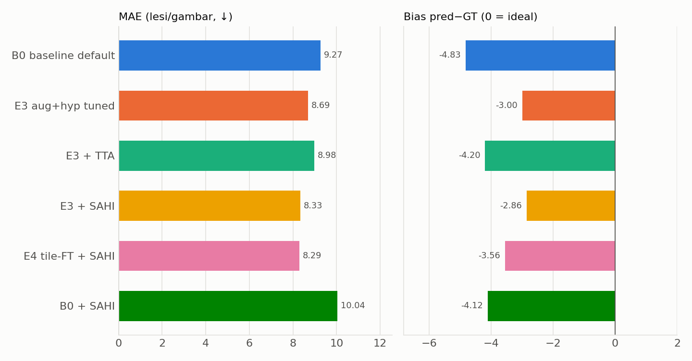
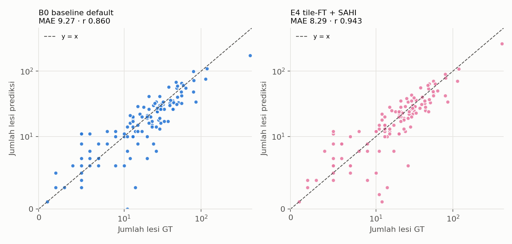
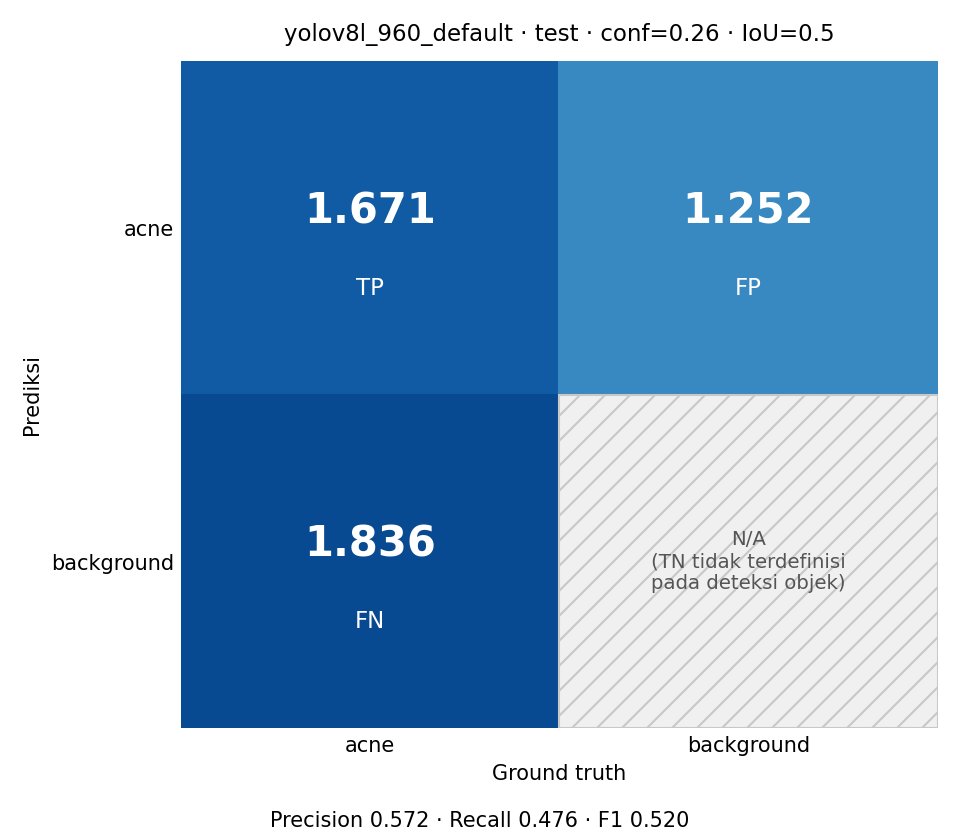
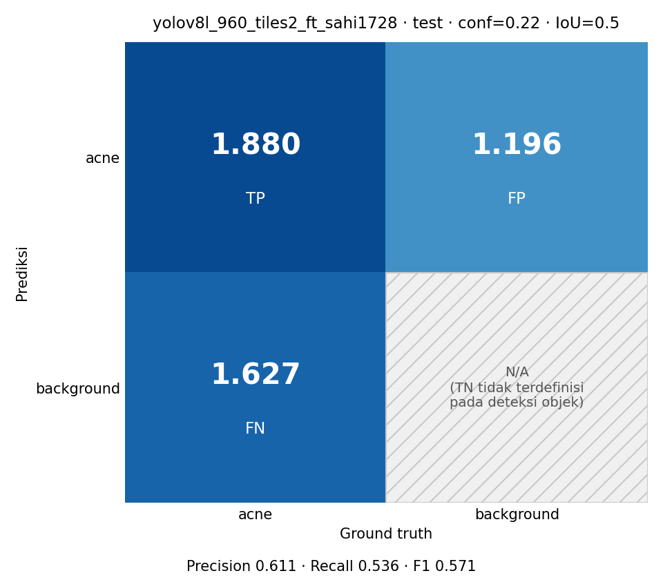
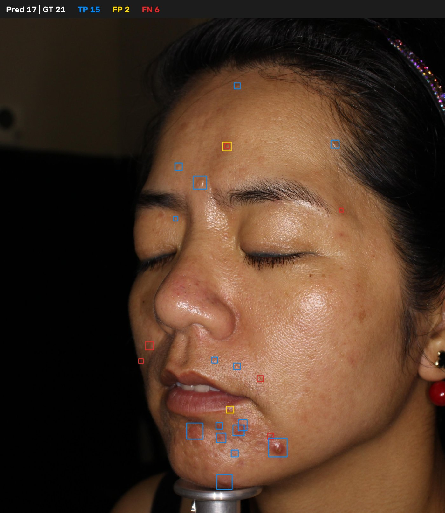
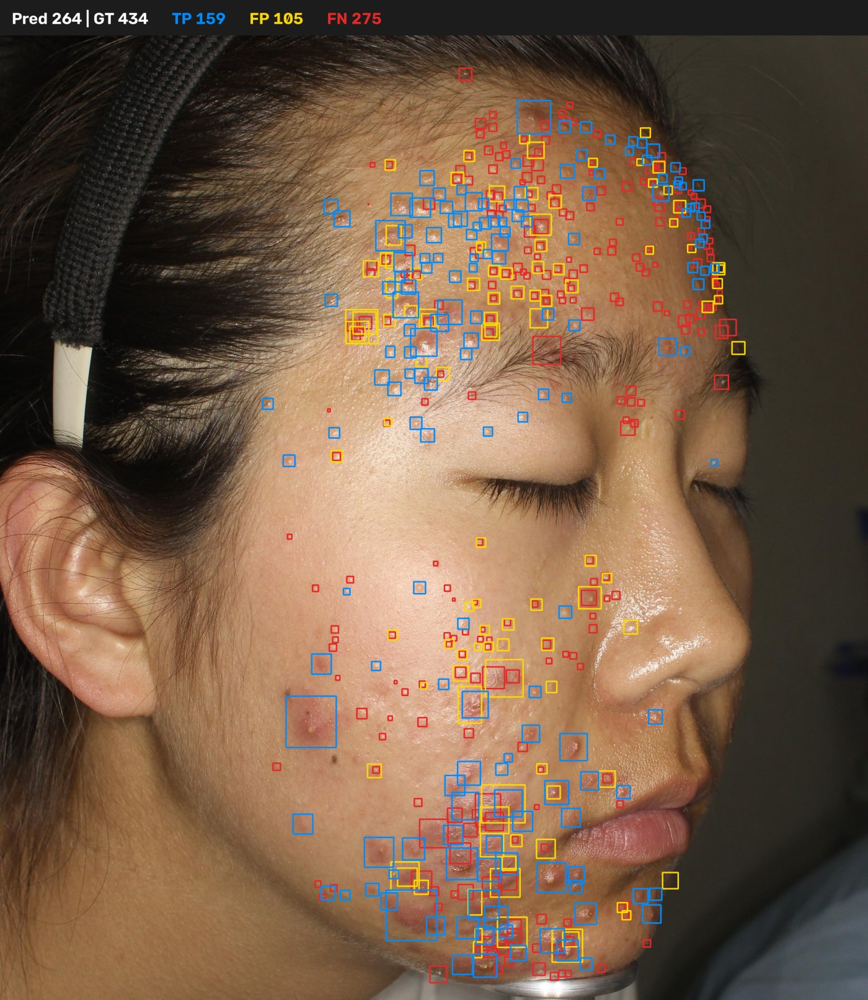

# Laporan Hasil Model AcneVision

> Tanggal: 2026-10-24 · `ultralytics 8.4.170`, `torch 2.6.0+cu124`, RTX 4060 8 GB
> Semua angka berasal dari artefak `runs/eval/<run>/metrics.json`, `counts_test.csv`,
> `runs/predict/<run>/test/predictions.csv`, dan `docs/report/{summary,bootstrap}.json`.
> Grafik dibuat oleh `scripts/report.py`. Bagian bertanda *opini* adalah interpretasi penulis.

---

## 0. Ringkasan Eksekutif

| | Baseline **B0** | Terbaik **E4 + SAHI** | Δ (bootstrap 95% CI) |
|---|---|---|---|
| Model | YOLOv8l default @960 | YOLOv8l tuned (E3) → fine-tune tile 2×2, inferensi SAHI 1728 px | |
| AP@50 (test, IoU 0.5) | 0.499 | **0.550** | +5.1 poin |
| Precision / Recall | 0.572 / 0.476 | **0.611 / 0.536** | Recall +0.059 [+0.040, +0.077] |
| F1 | 0.520 | **0.571** | +0.051 [+0.037, +0.066] |
| MAE counting (lesi/gambar) | 9.27 | **8.29** | −0.98 [−2.80, +0.26] (tidak signifikan) |
| Pearson r (jumlah) | 0.860 | **0.943** | |
| Latency end-to-end | **69 ms** | 628 ms | ±9× lebih lambat |

Test = 121 gambar, 3.507 lesi. Conf operasional dipilih di **val** (B0: 0.26, E4+SAHI: 0.22).

**Temuan utama:**
1. **Resolusi efektif adalah tuas terbesar.** SAHI (slice 1728 px → 960) menaikkan F1 dan recall secara
   signifikan. Fine-tune pada tile (E4) menambah sedikit (+1.0 poin F1, tidak signifikan vs E3+SAHI).
2. **Tuning augmentasi/hyperparameter (E3) tidak menaikkan deteksi** dibanding setelan default (B0):
   mAP@50 0.498 vs 0.4997. Perbaikan counting E3 (MAE 8.69 vs 9.27) juga tidak signifikan.
3. **TTA memperburuk** semua metrik deteksi (AP50 0.467 vs 0.491).
4. Model terbaik **memenuhi semua ambang "minimum layak"** di `SPEC.md`, dan ambang "baik" untuk
   Precision dan Pearson r. MAE (≤7) dan latency (<100 ms) belum mencapai "baik".
5. Kelemahan utama: **under-count pada wajah sangat padat** (1 gambar level 3: 264 dari 434 lesi) dan
   lesi < 16 px.

**Rekomendasi:** gunakan **E4 + SAHI 1728** bila akurasi diutamakan, atau **E3 plain** bila latency
< 100 ms dibutuhkan. Penetapan model terpilih di `SPEC.md` menunggu keputusan pengguna.

---

## 1. Tujuan & Cakupan

Mendeteksi dan **menghitung** lesi jerawat pada foto wajah (1 kelas `acne`). Counting adalah metrik
utama secara klinis; deteksi (mAP/P/R) mengukur kualitas lokalisasi. Cakupan laporan: pengembangan
model saja (serving/ONNX di luar cakupan).

## 2. Dataset

| Item | Nilai |
|---|---|
| Sumber | Gambar ACNE04 (Wu et al., ICCV 2019) + anotasi **ACNE04-v2** (Gazeau et al., MICCAI 2024) |
| Anotasi | Lingkaran (cx, cy, r) → bbox persegi `[cx±r, cy±r]` |
| Split (acak, seed 42) | 963 / 120 / 121 gambar · 25.521 / 3.366 / 3.507 lesi |
| Level keparahan test | level 0: 51 · level 1: 59 · level 2: 10 · level 3: **1** |
| Resolusi | ±3456×3112 px |

**Ukuran lesi** (train, sisi terpanjang bbox; sumber `PIPELINE.md` §1, `scripts/diagrams.py`):
median 42 px di resolusi asli. Pada `imgsz=960` median menjadi **11.7 px** dan **73.5%** lesi < 16 px
(`report/figures/lesion_size_hist.png`). Inilah alasan teknik berbasis
resolusi (SAHI, tiling) diprioritaskan.

## 3. Metodologi

### 3.1 Pipeline
```
data/ (YOLO) ─► train.py + configs/*.yaml ─► best.pt (dipilih di val)
                                         └─► evaluate.py ─► metrics.json, confusion matrix, counts_test.csv
data_tiles2/ (preprocess.py, tile 2×2) ─► E4 fine-tune             └─► predict.py --compare (121 gambar test)
```

### 3.2 Protokol evaluasi (`scripts/evaluate.py`)
1. **mAP Ultralytics** pada test: `conf=0.001`, `iou=0.7`, `max_det=1000`, `imgsz` = training
   (tidak tersedia untuk SAHI).
2. **AP@50 internal**: prediksi dicocokkan ke GT secara greedy (skor menurun, IoU ≥ 0.5), interpolasi
   101 titik. Satu definisi untuk semua mode (plain/TTA/SAHI), sehingga sebanding. Nilainya
   konsisten dengan mAP Ultralytics (B0: 0.4994 vs 0.4997). **mAP@50-95 internal** (ditambahkan
   2026-10-24, `map50_95_test_internal`) = rata-rata AP yang sama pada IoU 0.50:0.05:0.95. Diverifikasi
   ulang pada `predictions.json` Ultralytics (4 run plain/TTA): selisih ≤ 0.0002 (mAP@50) dan ≤ 0.0024
   (mAP@50-95). Hasil (test, `rerun_evals.ps1`): B0 0.1923, E3 0.1863,
   E3 + TTA 0.1810, E3 + SAHI 0.1945, E4 + SAHI 0.2046, B0 + SAHI 0.1903.
3. **Threshold conf operasional dipilih di val** (grid 0.05–0.60, MAE counting minimum), lalu
   diterapkan sekali ke test: Precision, Recall, F1, MAE, RMSE, bias, Pearson r, per level.
4. **Confusion matrix** pada conf operasional (§5.4).
5. **Signifikansi**: paired bootstrap per gambar (10.000 resample, seed 42) untuk selisih MAE, F1,
   dan recall (`docs/report/bootstrap.json`).
6. **Latency**: median waktu end-to-end per gambar test (baca gambar + inferensi + NMS), GPU idle.

### 3.3 Varian yang dibandingkan

| ID | Run (`runs/detect/`) | Perubahan | Training |
|---|---|---|---|
| **B0** | `yolov8l_960_default` | YOLOv8l COCO, **setelan default** Ultralytics (optimizer `auto`, augmentasi default), 100 epoch | 100 ep, best ep 80 |
| **E3** | `yolov8l_960` | AdamW lr0 1e-3 cosine, loss box 10 / cls 0.3 / dfl 2.0, flipud 0.5, degrees 10, mixup 0.1 | 100 ep, best ep 98 |
| E3 + TTA | (E3) | `augment=True` saat inferensi (flip + multi-skala) | – |
| E3 + SAHI | (E3) | Sliced inference: slice 1728 px, overlap 0.2, tiap slice di-resize ke 960, NMS IoU 0.5 | – |
| **E4** | `yolov8l_960_tiles2_ft` | **Preprocessing tile 2×2** (overlap 10%, gambar asli + 4 tile; 4.815 gambar train), fine-tune dari E3 `best.pt`, lr0 2e-4 | 10 ep (65 menit) |
| E4 + SAHI | (E4) | Seperti E3 + SAHI | – |
| B0 + SAHI | (B0) | Kontrol: SAHI tanpa fine-tune tile | – |

Catatan: E4 **tidak dilatih dari nol** karena anggaran GPU ≤ 4 jam. Riset teknik peningkatan dan
alasannya ada di `docs/RESEARCH.md` bagian A.

---

## 4. Riset Teknik Peningkatan (ringkas)

Detail dan sumber: `docs/RESEARCH.md` bagian A.

| Teknik | Diuji? | Hasil |
|---|---|---|
| Sliced inference (SAHI) [sahi] | Ya | **Signifikan positif** (F1 +0.047 vs E3) |
| Slicing-aided fine-tuning (tile) [sahi] | Ya (E4) | Positif kecil, tidak signifikan |
| Augmentasi + loss tuned (E3) | Ya | Tidak lebih baik dari default |
| TTA | Ya | Negatif |
| Threshold conf dipilih di val | Ya | MAE E3 9.85 → 8.69 vs conf 0.25 |
| Albumentations (CLAHE/Blur) | Temuan | Paket tidak terpasang, jadi tidak pernah aktif di run mana pun |
| `copy_paste` | Temuan | No-op untuk label bbox |
| imgsz 1280, head P2, 300 epoch | Tidak | Di luar anggaran (lihat §9) |

---

## 5. Hasil

Sumber tabel: `docs/report/summary.json` (dihasilkan `report.py` dari `runs/eval/*/metrics.json`).
Split test, matching IoU 0.5, conf dipilih di val.

### 5.1 Metrik deteksi

| Varian | mAP@50 (Ultralytics) | mAP@50-95 | AP@50 internal | conf (val) | Precision | Recall | F1 | TP | FP | FN |
|---|---|---|---|---|---|---|---|---|---|---|
| B0 baseline | 0.4997 | 0.1931 | 0.4994 | 0.26 | 0.5717 | 0.4765 | 0.5198 | 1.671 | 1.252 | 1.836 |
| E3 tuned | 0.4980 | 0.1914 | 0.4909 | 0.21 | 0.5445 | 0.4882 | 0.5148 | 1.712 | 1.432 | 1.795 |
| E3 + TTA | 0.4746 | 0.1771 | 0.4671 | 0.28 | 0.5302 | 0.4534 | 0.4888 | 1.590 | 1.409 | 1.917 |
| E3 + SAHI | – | – | 0.5370 | 0.23 | 0.5925 | 0.5341 | 0.5618 | 1.873 | 1.288 | 1.634 |
| E4 (plain) | 0.4968 | 0.1891 | 0.4895 | 0.22 | 0.5251 | 0.4953 | 0.5098 | 1.737 | 1.571 | 1.770 |
| **E4 + SAHI** | – | – | **0.5499** | 0.22 | **0.6112** | **0.5361** | **0.5712** | 1.880 | 1.196 | 1.627 |
| B0 + SAHI | – | – | 0.5113 | 0.34 | 0.5685 | 0.4876 | 0.5249 | 1.710 | 1.298 | 1.797 |


### 5.2 Metrik counting

| Varian | MAE | RMSE | Bias | Pearson r | MAE tanpa level 3 | Latency (ms) |
|---|---|---|---|---|---|---|
| B0 baseline | 9.27 | 25.99 | −4.83 | 0.8604 | 7.18 | 69.4 |
| E3 tuned | 8.69 | 20.18 | −3.00 | 0.9096 | 7.19 | 69.5 |
| E3 + TTA | 8.98 | 19.56 | −4.20 | 0.9194 | – | 114.9 |
| E3 + SAHI | 8.33 | **17.97** | **−2.86** | **0.9457** | 7.05 | 636.9 |
| E4 (plain) | 8.45 | 20.68 | −1.64 | 0.9102 | **6.88** | 69.4 |
| **E4 + SAHI** | **8.29** | 18.66 | −3.56 | 0.9425 | 6.94 | 628.4 |
| B0 + SAHI | 10.04 | 24.92 | −4.12 | 0.8912 | 8.09 | 641.6 |

Bias negatif = under-count. "MAE tanpa level 3" mengeluarkan 1 gambar dengan 434 lesi
(dihitung dari `counts_test.csv`), karena gambar ini mendominasi RMSE.





### 5.3 Per level keparahan (MAE / recall)

| Level (n) | B0 | E3 | E3 + SAHI | E4 + SAHI |
|---|---|---|---|---|
| 0 (51) | 5.67 / 0.450 | 5.27 / 0.472 | 5.16 / 0.521 | **5.06 / 0.525** |
| 1 (59) | **8.08** / 0.509 | 8.46 / 0.506 | 8.86 / 0.546 | 8.31 / **0.557** |
| 2 (10) | 9.50 / 0.585 | 9.50 / 0.587 | **6.00 / 0.622** | 8.50 / 0.622 |
| 3 (1) | 261 / 0.263 | 188 / 0.323 | **162 / 0.399** | 170 / 0.366 |

Level 3 hanya 1 gambar dan level 2 hanya 10, sehingga angka keduanya tidak andal.


### 5.4 Confusion matrix

Pada deteksi objek, sel **background–background (True Negative) tidak terdefinisi**: jumlah
"bukan-lesi yang benar diabaikan" tak terhingga (setiap posisi/skala kotak). Karena itu sel tersebut
ditandai N/A, bukan dibiarkan kosong tanpa penjelasan. Matriks lama Ultralytics dibuat pada
`conf=0.001` (57.574 FP), sehingga tidak bermakna. Versi baru memakai conf operasional dari val.

| B0 baseline (conf 0.26) | E4 + SAHI (conf 0.22) |
|---|---|
|  |  |

Matriks semua varian: `docs/report/figures/cm_*.png`.

**Jenis FP** (`fp_breakdown` di `metrics.json`): FP *lokalisasi* = overlap 0.1 ≤ IoU < 0.5 dengan lesi
GT (kotak salah ukuran/posisi); FP *latar* = tanpa overlap.

| Varian | FP lokalisasi | FP latar |
|---|---|---|
| B0 | 657 | 595 |
| E3 | 866 | 566 |
| E3 + SAHI | 494 | 794 |
| E4 + SAHI | 500 | 696 |

SAHI memangkas FP lokalisasi (kotak lebih presisi pada resolusi tinggi), tetapi menambah FP latar.

### 5.5 Uji signifikansi (paired bootstrap, 95% CI)

Sumber: `docs/report/bootstrap.json`. Δ = varian A − varian B. **Tebal** = CI tidak memuat 0.

| A − B | Δ MAE | Δ F1 | Δ Recall |
|---|---|---|---|
| E4+SAHI − B0 | −0.98 [−2.80, +0.26] | **+0.051 [+0.037, +0.066]** | **+0.059 [+0.040, +0.077]** |
| E4+SAHI − E3 | −0.40 [−1.15, +0.36] | **+0.057 [+0.045, +0.069]** | **+0.048 [+0.033, +0.064]** |
| E4+SAHI − E3+SAHI | −0.05 [−0.65, +0.56] | +0.010 [−0.004, +0.024] | +0.003 [−0.011, +0.017] |
| E3 − B0 | −0.58 [−2.17, +0.64] | −0.005 [−0.018, +0.008] | +0.011 [−0.007, +0.027] |
| E3+SAHI − E3 | −0.35 [−1.23, +0.47] | **+0.047 [+0.035, +0.057]** | **+0.046 [+0.033, +0.057]** |
| E4 − E3 (plain) | −0.23 [−0.94, +0.47] | −0.005 [−0.018, +0.009] | +0.008 [−0.009, +0.027] |
| B0+SAHI − B0 | +0.77 [−0.06, +1.58] | +0.005 [−0.011, +0.019] | +0.011 [−0.004, +0.024] |

Interpretasi:
- Kenaikan **deteksi** (F1/recall) dari SAHI pada model E3/E4 nyata.
- Perbedaan **MAE** antar varian belum bisa dibedakan dari noise dengan 121 gambar test.
- SAHI **tidak** membantu B0 (B0 + SAHI). *Opini*: augmentasi E3 (`scale`, `degrees`, mosaic) membuat
  model lebih tahan terhadap perubahan skala lesi saat slicing.

### 5.6 Kurva training


mAP@50 val selama training (B0 dan E3). Kurva E4 tidak diplot karena val-nya berisi tile
(`data_tiles2`), sehingga tidak sebanding. B0 mencapai puncak di epoch 80 (0.483), E3 di epoch 98
(0.467). E3 masih naik di akhir, jadi belum konvergen.

---

## 6. Perbandingan dengan Standar Minimum

Ambang dari `SPEC.md` §5 (diturunkan dari literatur, `RESEARCH.md` bagian B). Model: **E4 + SAHI**
(test, conf 0.22 dipilih di val).

| Metrik | Nilai | Minimum layak | Baik | Status |
|---|---|---|---|---|
| mAP@50 | 0.550 (AP@50 internal)¹ | ≥ 0.45 | ≥ 0.55 | ✅ minimum, tepat di batas baik |
| Recall | 0.536 | ≥ 0.50 | ≥ 0.60 | ✅ minimum |
| Precision | 0.611 | ≥ 0.50 | ≥ 0.60 | ✅ **baik** |
| MAE counting | 8.29 | ≤ 10 | ≤ 7 | ✅ minimum |
| Pearson r | 0.943 | ≥ 0.85 | ≥ 0.90 | ✅ **baik** |
| Inferensi | 628 ms | < 1 s | < 100 ms | ✅ minimum |

¹ mAP Ultralytics tidak tersedia untuk SAHI; AP@50 internal setara (selisih ≤ 0.009 pada mode plain).

**Baseline B0** gagal di ambang Recall (0.476 < 0.50), dan Pearson r-nya (0.860) hanya tipis di atas
ambang minimum. **Siap klinis** tetap membutuhkan validasi terhadap beberapa dermatolog (ICC ≥ 0.75).
Metrik dataset saja tidak cukup.

Konteks literatur: AcneAI melaporkan TPR 0.52 pada FPR 0.09 pada dataset yang sama (ACNE04-v2).
Recall kita 0.536 berada di kisaran yang sama. Protokolnya berbeda, jadi ini bukan perbandingan langsung.

---

## 7. Prediksi Seluruh Test Set & Analisis Error

Semua 121 gambar test diprediksi dengan `predict.py --compare`. Jumlah TP/FP/FN identik dengan
`evaluate.py`.

| Model | Output | Total TP / FP / FN | MAE |
|---|---|---|---|
| B0 (conf 0.26) | `runs/predict/yolov8l_960_default_plain/test/` | 1.671 / 1.252 / 1.836 | 9.27 |
| E4 + SAHI (conf 0.22) | `runs/predict/yolov8l_960_tiles2_ft_sahi/test/` | 1.880 / 1.196 / 1.627 | 8.29 |

Tiap folder berisi 121 gambar + `predictions.csv`. Legenda: **biru** = TP, **kuning** = FP,
**merah** = FN (lesi terlewat). Tidak ada teks di atas wajah; jumlah ditulis di strip header.

### 7.1 Contoh (E4 + SAHI)

**Terbaik**: `levle1_482` (GT 21, pred 17, F1 0.79)



**F1 terendah**: `levle1_288` (GT 16, pred 25, TP 4 / FP 21 / FN 12)


**Under-count terbesar**: `levle3_89` (GT 434, pred 264, FN 275)



Versi B0 untuk gambar yang sama: `docs/report/figures/examples/*_b0.jpg`.

### 7.2 Pola error

1. **Lesi tiny di area padat terlewat (FN).** Pada `levle3_89`, mayoritas FN berupa kotak merah
   sangat kecil yang berdempetan di dahi dan pipi. Lima under-count terbesar terjadi pada gambar
   dengan GT ≥ 48 lesi, antara lain `levle1_528` (85 → 34), `levle1_381` (114 → 70), dan
   `levle1_566` (79 → 42).
2. **Kesalahan skala/lokalisasi.** Kotak prediksi yang lebih besar mengelilingi lesi GT kecil (IoU < 0.5),
   sehingga dihitung sebagai FP + FN sekaligus. Hal ini terlihat di dagu pada `levle1_288`.
3. **FP pada bekas/makula samar.** Banyak FP di `levle1_288` berada di bintik kemerahan di pipi.
   *Opini*: sebagian kemungkinan lesi atau bekas yang tidak dianotasi. Ini konsisten dengan catatan
   paper AcneAI bahwa anotasi ACNE04 tidak lengkap.
4. **Bias negatif sistematis** di semua varian (−1.6 s.d. −4.8 lesi/gambar): model cenderung under-count.

---

## 8. Kesimpulan

1. Model terbaik **E4 + SAHI** memenuhi seluruh ambang minimum layak, dengan F1 0.571, recall 0.536,
   MAE 8.29, dan r 0.943 pada test.
2. Peningkatan terhadap baseline **signifikan untuk deteksi** (F1 +0.051, recall +0.059), tetapi **belum
   signifikan untuk MAE counting**.
3. Kontributor utamanya **sliced inference**. Tuning augmentasi/hyperparameter E3 dan fine-tune tile E4
   masing-masing memberi efek kecil yang tidak signifikan bila berdiri sendiri. Namun E3 diperlukan
   agar SAHI efektif (B0 + SAHI tidak membaik).
4. Trade-off: SAHI ±9× lebih lambat (±630 ms vs ±69 ms per gambar), masih di bawah target minimum 1 s.

## 9. Keterbatasan

- **Satu seed per konfigurasi**. Variasi antar-seed tidak diukur; selisih kecil (E4 vs E3+SAHI) bisa
  berasal dari noise.
- **E4 hanya fine-tune 10 epoch** dari E3, bukan training tile dari nol (anggaran GPU ≤ 4 jam).
- **Test kecil & tidak terstratifikasi**: level 3 n=1, level 2 n=10.
- **Kemungkinan kebocoran antar-pasien** belum terverifikasi (ID pasien tidak tersedia).
- **Konversi lingkaran → bbox** menekan mAP@50-95. Anotasi dasar diduga tidak lengkap (§7.2).
- B0 dilatih dalam dua sesi (dihentikan di epoch 45 karena RAM sistem, lalu dilanjutkan dari
  `last.pt`). *Opini*: pengaruhnya kecil karena state optimizer ikut tersimpan.
- `albumentations` tidak terpasang, jadi augmentasi CLAHE/Blur bawaan tidak pernah aktif.

## 10. Rekomendasi Berikutnya

Detail antrian: `docs/ROADMAP.md`.

1. **Training tile dari nol** (atau imgsz 1280) dengan epoch lebih panjang, karena resolusi efektif
   terbukti tuas utama.
2. **Head P2** (stride 4) untuk lesi < 16 px.
3. **Multi-seed** (≥ 3) untuk varian kandidat, agar selisih kecil bisa diuji.
4. **Split terstratifikasi per level** + pemeriksaan duplikat/pasien.
5. Kurangi latency SAHI: slice lebih besar, batch slice, atau ekspor TensorRT (di luar cakupan saat ini).

## 11. Reproduksi

```powershell
# Training
.venv\Scripts\python.exe scripts\train.py --cfg configs\yolov8l_960_default.yaml     # B0
.venv\Scripts\python.exe scripts\train.py --cfg configs\yolov8l_960.yaml             # E3
.venv\Scripts\python.exe scripts\data\preprocess.py --grid 2 --overlap 0.1           # data_tiles2/
.venv\Scripts\python.exe scripts\train.py --cfg configs\yolov8l_960_tiles2_ft.yaml   # E4
# Evaluasi semua varian + fine-tune E4 (berurutan)
powershell -ExecutionPolicy Bypass -File scripts\run_experiments.ps1
# Prediksi seluruh test
cd scripts
..\.venv\Scripts\python.exe predict.py --source ..\data\images\test --weights ..\runs\detect\yolov8l_960_default\weights\best.pt --compare --conf 0.26
..\.venv\Scripts\python.exe predict.py --source ..\data\images\test --weights ..\runs\detect\yolov8l_960_tiles2_ft\weights\best.pt --sahi --slice 1728 --compare --conf 0.22
# Grafik & ringkasan laporan
..\.venv\Scripts\python.exe report.py
```

## Referensi

- [sahi] Akyon et al., *Slicing Aided Hyper Inference and Fine-tuning for Small Object Detection*, ICIP 2022. https://arxiv.org/abs/2202.06934
- [acneai] Gazeau et al., *AcneAI*, MICCAI 2024. https://link.springer.com/chapter/10.1007/978-3-031-72086-4_7
- Ultralytics Configuration: https://docs.ultralytics.com/usage/cfg/ · Validation: https://docs.ultralytics.com/modes/val/
- Literatur ambang metrik lengkap: `docs/RESEARCH.md` bagian B.
